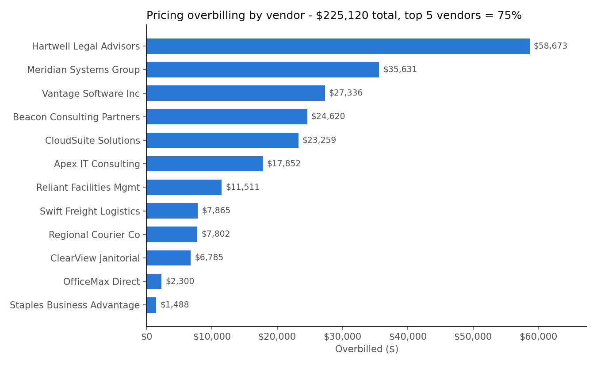
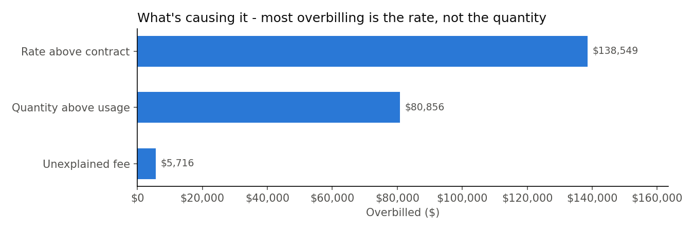
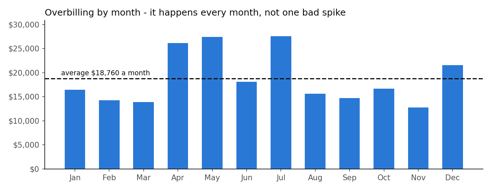

# Vendor Invoice & Billing Discrepancy Audit

**Python (pandas, openpyxl, matplotlib) · SQL (SQLite + SQL Server version) · Excel**

I built this to practice the kind of check I help with at work - making sure what we get billed matches what we agreed to pay and what was actually provided. I can't share any work data, so everything here is **fake data I generated**.

## Live dashboard

**[Open the dashboard](https://bunmii234.github.io/vendor-invoice-audit/)** - one page with the results, charts, and a searchable dispute list. No code or downloads needed. Start with the "pick a question" buttons at the top.

## Results at a glance







The full report is `output/Vendor_Billing_Audit.xlsx` (GitHub can't preview Excel - click it, then **Download**). To see the flagged invoices right here, open [`output/flagged_invoices.csv`](output/flagged_invoices.csv).

## The problem

A vendor should bill **contract rate x quantity used**. But in real life:

- the rate slowly creeps above the contract
- they bill for more than we used
- random fees show up
- the same bill gets sent twice

If you only look at whether an invoice total "looks about right," you miss all of that. You only catch it by checking every invoice against the contract AND against your own records.

## The data - 3 tables (+ an answer key)

| File | What it is | Rows |
|---|---|---|
| `data/raw/invoices_raw.csv` | what the vendors billed | 1,462 invoices |
| `data/raw/contracts.csv` | what we agreed to pay | 12 vendors |
| `data/raw/usage_log.csv` | what our own records say we used | 1,400 jobs |
| `data/answer_key.csv` | which problem I planted on which invoice | 1,462 rows |

Nothing in the invoices says which ones are wrong - the audit has to find them. The answer key is only used at the end, to grade the audit. The export is also messy on purpose: **36 spellings of 12 vendor names** and **2 date formats**, like a real system export.

## What I did - 7 steps

| Step | File | Tool | What it does |
|---|---|---|---|
| 1 | `python/01_generate_data.py` | Python | makes the 3 fake tables + the answer key |
| 2 | `python/02_clean_invoices.py` | pandas | fixes vendor names (36 -> 12), reads both date formats, stops if anything fails a check |
| 3 | `python/03_run_audit.py` + `sql/` | SQL | runs 4 checks with JOINs and totals the results |
| 4 | `python/04_check_accuracy.py` | pandas | grades the audit against the answer key - caught, missed, false alarms |
| 5 | `python/05_build_excel_report.py` | pandas + openpyxl | builds a 7-sheet Excel report with a chart and a dispute list |
| 6 | `python/06_make_charts.py` | matplotlib | saves the charts as pictures for this page |
| 7 | `python/07_build_dashboard.py` + `dashboard/` | Python + HTML | builds the live dashboard (`docs/index.html`) |

### The 4 checks (`sql/audit_checks.sql`)

1. **Rate above contract** - JOIN invoices to contracts. Flag if the billed rate is more than 0.5% over the contract rate.
2. **Quantity above usage** - JOIN invoices to the usage log. Flag if they billed more than we used.
3. **Unexplained fee** - the total doesn't equal rate x quantity.
4. **Likely duplicate** - SELF-JOIN (the table joined to itself). Same vendor, same quantity, same amount within 14 days, and no usage record of its own.

## What I found

- **$225,120.73 overbilled** across **395 invoices** (about 27% of all invoices)
- **5 of the 12 vendors = 75.3%** of it. One vendor alone was $58,673
- By cause: rate above contract **$138,549** · quantity above usage **$80,856** · unexplained fees **$5,716**
- **62 likely duplicate invoices** - **$344,515** that could get paid twice
- **It happens every month** - about $18,760 a month on average, never close to zero. That's a process problem, not one bad invoice.

### Stop it, or get it back?

| What Finance can do | Invoices | Dollars |
|---|---|---|
| **Can still stop** - pending, not paid yet | 74 | $189,842 |
| **Need to recover** - approved, probably already paid | 367 | $367,398 |
| Already rejected | 16 | $12,395 |

Most of the money was already approved - that's the case for running these checks **before** approval, not after.

### Did the audit actually work?

Because I made the data, I know exactly which problems I planted. Step 4 grades the audit against that answer key:

| Planted problem | Planted | Caught |
|---|---|---|
| Rate a little high (2-6%) | 164 | 164 |
| Rate way high (15-40%) | 73 | 73 |
| Padded quantity | 96 | 96 |
| Hidden fee | 62 | 62 |
| Duplicate bill | 62 | 62 |
| **Total** | **457** | **457** |

**0 false alarms** on the 1,005 clean invoices. (See Limitations - real data would be messier.)

## The hard part

Deciding where "a little high" ends and "overcharged" starts. A 0.5% buffer ignores rounding but still catches small 2-6% rate creep, which is the easiest kind to miss.

For duplicates, matching amounts alone wasn't enough - it flagged a few real repeat orders by mistake. Adding "no usage record" fixed that.

## Limitations

- **It's fake data.** The problems were planted by the same script, so catching 100% is expected. Real invoices would have problems I didn't think of, and the score would be lower.
- **The 0.5% buffer is my choice.** With real data I'd check it with Finance - some contracts allow small price increases.
- **"Approved" doesn't always mean paid.** I'm assuming approved invoices were paid. With real data I'd check the payment records.
- **Duplicates need the usage log.** If a company doesn't track usage, the duplicate check would need another rule.

## Run it yourself

Open a terminal in this folder, then:

```
pip install -r requirements.txt
python run_all.py
```

`run_all.py` runs all 7 steps in order. The report shows up at `output/Vendor_Billing_Audit.xlsx` (7 sheets: **Summary · By Vendor · By Issue · Stop or Recover · By Month · Dispute List · Accuracy Check**) and the dashboard at `docs/index.html`.

**SQL Server:** the project runs on SQLite, but [`sql_server/audit_checks_sqlserver.sql`](sql_server/audit_checks_sqlserver.sql) shows the same queries written for SQL Server (`DATEDIFF` instead of `julianday`, `TOP` instead of `LIMIT`, `FORMAT` instead of `strftime`).

Every code file has notes under each block explaining what that part does - I wrote them as I learned it.
